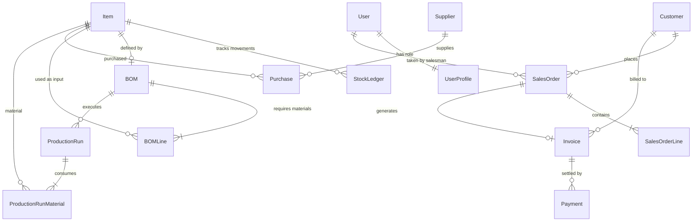

# System Design Note — Order-to-Audit ERP

## 1. Core Architectural Principle
Every operational event (purchase, production run, dispatch, credit note) is recorded **once at its source** inside a database transaction (`transaction.atomic()`). Stock balances are never overwritten directly; instead, every movement writes an immutable row to `StockLedger`, and current stock is always derived as `SUM(quantity_delta)`.

## 2. Entity-Relationship (ER) Data Model

## 3. Stock Ledger & BOM Consumption Logic
* **Exact Arithmetic:** All monetary fields use `DecimalField(max_digits=14, decimal_places=2)` and quantities use `DecimalField(max_digits=12, decimal_places=3)`. Unit conversions (`kg ↔ g`, `litre ↔ ml`, `carton ↔ packet`) are handled via `Decimal` factors in `erp/services.py`.
* **Atomic Production Run:** When a supervisor saves a run for $B$ batches:
  1. **Expected Output** = $\text{BOM.expected\_output} \times B$.
  2. **Yield Variance (%)** = $\frac{\text{Actual Output} - \text{Expected Output}}{\text{Expected Output}} \times 100$. Flagged if $|\text{variance}| > \text{tolerance}$ (default 3%).
  3. **Material Consumption:** For each BOM line, both `actual_qty` (`PROD_ISSUE`) and `wastage_qty` (`WASTAGE`) write negative `quantity_delta` rows to `StockLedger`, linked via `reference_type='ProductionRun'` and `reference_id=run.id`.
  4. **Material Variance (%)** = $\frac{(\text{Actual} + \text{Wastage}) - \text{Planned}}{\text{Planned}} \times 100$. Flagged if $|\text{variance}| > \text{tolerance}$.
  5. **Finished Goods Receipt:** `actual_output` writes a positive `PROD_OUTPUT` row to `StockLedger`.
* **Sales Dispatch & Credit Notes:** Dispatch checks live stock (`SUM(quantity_delta)`) and blocks fulfilment if any line has a shortage. Posted invoices cannot be deleted; cancelling an invoice sets `is_cancelled=True` and posts positive `CREDIT_NOTE` reversal rows to `StockLedger`, logged in `AuditLog`.

## 4. Valuation & Costing Methodology
* **Inventory Valuation — Weighted Average Cost:**
  $$\text{Unit Cost} = \frac{\sum (\text{Inbound Qty} \times \text{Inbound Unit Cost})}{\sum \text{Inbound Qty}}$$
  Computed over `OPENING` and `PURCHASE` ledger entries. Weighted average was chosen over Last Price (too volatile for agricultural inputs like flour/oil) and FIFO (unnecessary lot-tracking overhead for bulk raw materials in a small factory).
* **Overhead Allocation — Direct Run Allocation:**
  Labour and gas/power overheads entered against a run are added directly to the run's total material cost (including damaged packaging/wastage) and divided by **good salable packets**:
  $$\text{Cost per Packet} = \frac{\text{Total Material Cost} + \text{Labour Cost} + \text{Overhead Cost}}{\text{Actual Good Output}}$$
* **Benchmark Walkthrough (Murukku 200 g):**
  * Flour weighted avg = $\frac{(100 \times 42) + (60 \times 45)}{160} = ₹43.125/\text{kg} \rightarrow 40 \text{ kg} = ₹1,725.00$
  * Oil ($10.5 \times 140 = ₹1,470$), Spice ($1.2 \times 200 = ₹240$), Pouches ($194 \times 2.50 = ₹485$), Cartons ($9 \times 15 = ₹135$)
  * Total Material = $₹4,055.00$; plus Labour ($₹1,200$) + Gas/Power ($₹600$) = $₹5,855.00$
  * **Cost per Packet** = $\frac{₹5,855.00}{188} = \mathbf{₹31.14}$ (Gross Margin: ₹18.86/packet at ₹50 pre-tax selling price).